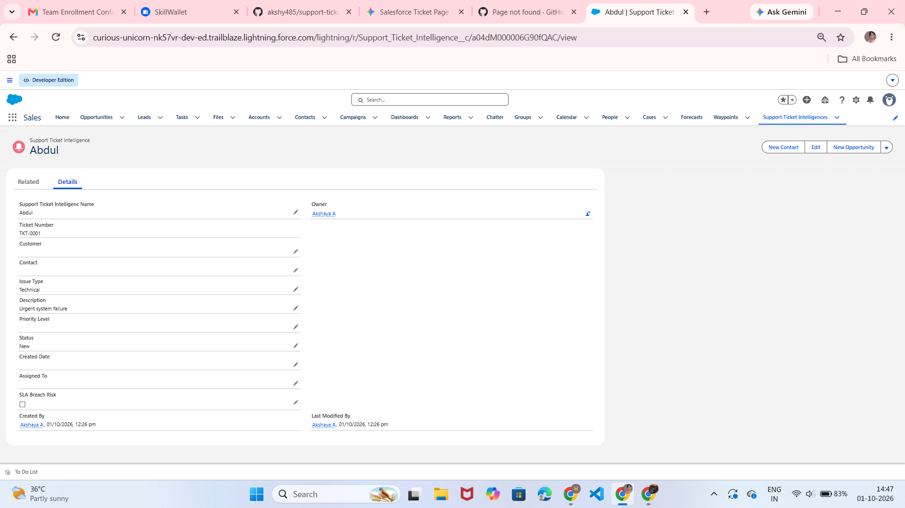

# Support Ticket Priority Prediction and Automated Assignment System Using Agentforce

## 1. Project Overview

This project presents an intelligent support ticket management system built on the Salesforce platform. It automates ticket priority classification, assigns high-priority tasks, and streamlines agent workflows using Salesforce Autolaunched Flows and Agentforce AI Agent configurations.

## 2. Business Value & Key Objectives

- **Faster Ticket Resolution:** Prioritizes critical issues automatically.
- **Reduced Manual Effort:** Replaces manual ticket review with automated logic.
- **Intelligent Workload Management:** Assigns high-priority tickets to suitable support agents.

## 3. Custom Object Data Model

**Object Name:** Support Ticket Intelligence

**API Name:** `Support_Ticket_Intelligence__c`

| Field Label | API Name | Data Type | Description |
|---|---|---|---|
| Ticket Number | `Ticket_Number__c` | Auto Number | TKT-{0000} |
| Customer | `Customer__c` | Lookup (Account) | Related Account |
| Contact | `Contact__c` | Lookup (Contact) | Customer Contact |
| Issue Type | `Issue_Type__c` | Picklist | Technical, Billing, General |
| Description | `Description__c` | Long Text Area | Issue details |
| Priority Level | `Priority_Level__c` | Picklist | Low, Medium, High |
| Status | `Status__c` | Picklist | New, In Progress, Resolved |
| Created Date | `Created_Date__c` | Date | Ticket Date |
| Assigned To | `Assigned_To__c` | Lookup (User) | Support Agent |
| SLA Breach Risk | `SLA_Breach_Risk__c` | Checkbox | Risk Flag |

## 4. Flow Architecture & Automation Logic

**Flow Type:** Auto-Launched Flow integrated with Agentforce.

1. **Get Account Records:** Fetches account details using `varAccountName`.
2. **Get Support Ticket:** Retrieves the relevant support ticket associated with the account.
3. **Keyword Analysis:** Classifies tickets based on description keywords.
   - **High Priority:** "urgent", "not working", or "failure".
   - **Medium Priority:** "issue", "slow", or "delay".
   - **Low Priority:** Default fallback category.
4. **Action & Task Assignment:**
   - Creates a high-priority follow-up task when a high-priority ticket is detected.
   - Sets output variables such as `varPriorityLevel`, `varAssignedTo`, and `varActionMessage`.

## 5. Agentforce AI Configuration

- **Topic Label:** Support Ticket Priority Analysis
- **API Name:** `Support_Ticket_Priority_Analysis`
- **Classification:** Analyzes support ticket details, identifies urgency, and triggers Flow automation.
- **Agent Action:** `Support_Ticket_Intelligence_c`
- **Reference Flow:** `Support_Ticket_Intellegence`
- **Input Parameter:** `varAccountName`
- **Output Parameters:** `varAccountId`, `varTicketId`, `varPriorityLevel`, `varAssignedTo`, `varActionMessage`

## 6. Proof of Functionality & Screenshots

### 6.1 Flow Debug Proof Log

### 6.2 Support Ticket Intelligence Records Page

## 7. Project Status

- **Salesforce Custom Object & Fields:** Completed and verified.
- **Auto-Launched Flow Logic:** Completed, debugged, and tested.
- **Agentforce Integration:** Designed and configured as implemented in the project.

## 8. Conclusion

This project uses Salesforce Flow and Agentforce to improve ticket prioritization, automate support workflows, and help support teams handle critical customer issues efficiently.
